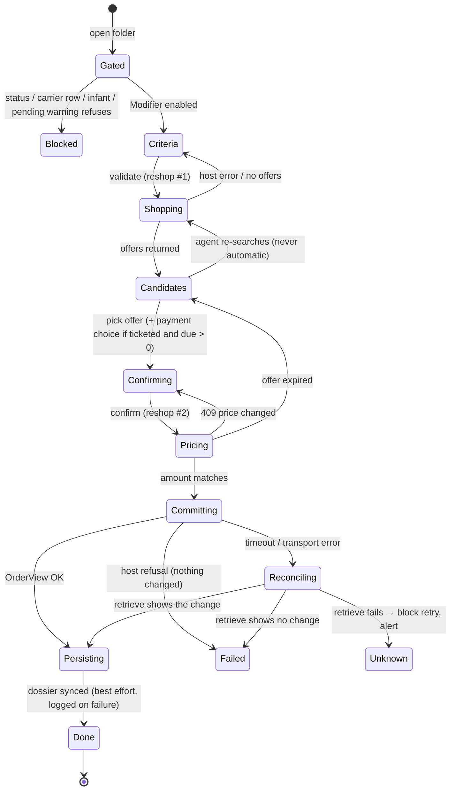

# NDC[X] flight modification — implementation plan (v3.1)

Ticket context: MET2-2422, branch `deyra-met2-2422` in both `api-aerial` and `front-reservation`.
Written 2026-10-25. Revises v2 (`ndcx-flight-modification-plan-v2.md`) with owner decisions D4
(fare difference paid with the saved form of payment) and D8 (exchange recorded automatically by
`modificationFlight`). v1 and v2 are left untouched. Read-only investigation: no code, branch or
commit was touched.

v3.1 (same day): the D8 wiring was reviewed against every existing `modificationFlight` caller
(AFKL, SABRE, IB, BA, TK, GOKYTE). New §3.7. It changes §4.1 D8, §5, §6.4, §6.7, §8.2, §9, §11, §12, §13.

> STATUS: complete (v3.1). Planning only. D4 and D8 are resolved by the owner, **but each exposes a code conflict**:
> - **Blocking open question (D4):** the saved form of payment is the card on `pnr.EnrollmentStatusText`, and the code deletes its PAN and CVV right after ticketing. Paying a ticketed card-paid exchange with it cannot work until this is resolved (§3.3, §4.3).
> - **Blocking gap (D8):** the NDC[X] exchange path does **not** call `modificationFlight`. It calls `saveAfterRetreive` only (§3.6). Wiring it needs input adapters, a preflight and a fixed call order; passing the NDC[X] reply as is fails silently (§3.7, §6.4).
> - Still open: D9 (production pilot carrier).

Paths below are relative to:
- backend `C:\Users\anasd\metis\api-aerial\` (branch `deyra-met2-2422`, HEAD `004fd7cc3`);
- frontend `C:\Users\anasd\metis\front-reservation\` (branch `deyra-met2-2422`);
- skill `C:\Users\anasd\metis\.agents\skills\ndcx\` (written `skill/…`).

Every path named was checked to exist. Line numbers are as of 2026-10-25.

---

## 0. What changed since v1 (and v3 delta)

**v3 delta (this revision only):**

| Owner decision | Effect on the plan |
|---|---|
| D4 — fare difference paid with the saved form of payment from the database, at the exchange confirmation step | §3.3 (code check), §4.1 D4, §4.3, §6.2, §6.4, §7.6, §8.2, §9, §10.3, Phases 1 and 3. Options A/B/C of v2 are dropped as the design. **Blocking open question:** the saved card is purged at ticketing. |
| D8 — the exchange is recorded automatically when `modificationFlight` is called | §3.5, §3.6 (new), §4.1 D8, §6.4, §9, §11, §12, §13. The "check with the accounting owner" item is removed. **Blocking gap:** NDC[X] does not call that function today. |
| All other v2 decisions | Unchanged. |
| v3.1 — D8 wiring review against the reference callers | New §3.7 (findings F1–F9). Replaces v3's "exactly one of `modificationFlight` / `saveAfterRetreive`" by "`modificationFlight` first, then the refresh", as AFKL and GOKYTE do. Held changes also go through `modificationFlight` (F7). Adds `changedBounds` to the change request (§8.2). |

**v2 table (unchanged, for history):**

| Owner decision | Effect on the plan |
|---|---|
| 1. Double-check "ticketed only" | Checked. It is **not** an Amadeus rule and **not** a backend gate. It was v1's own scoping choice. See §3.1. |
| 2. Held bookings can be changed | Checked. **Confirmed by the airline matrix** for 9 of the 18 in-scope carriers plus the AA test pilot, with a different payment model (deferred). Brought into scope. See §3.2. |
| 3. No certification | All certification cases, checklists, packaging and the "who certifies" question are removed. Validation = our unit/fixture tests + manual test-host runs + controlled production checks. §10. |
| 4. Pay the fare difference with the card saved in the PNR | (v3: now D4, see the delta above.) Checked. **True for held orders, false for ticketed orders**: the card is stored encrypted on our `pnr` row (not in the Amadeus PNR), and the PAN and CVV are deliberately purged right after ticketing. Exchange payment needs a user decision. See §3.3 and D4. |
| 5. Held bookings = same as decision 1 | In scope, subject to §3.2 and a test-host spike before any UI work (Phase 2). |
| 6. Capabilities matrix | Per-airline table built from `skill/references/airline-matrix.csv` and compared with `carrierCapabilities.js`. See §3.4. |
| 7. Defer involuntary changes | Detection, acceptance and involuntary exchange removed from the body. A short note remains in Appendix A, marked "deferred, out of scope". |
| 8. Remove waiver codes | Removed entirely: no waiver map, no `FareWaiver` element, no waiver question. Not carried into the appendix either. |
| 9. Keep v1 defaults elsewhere | Kept: credit-due (residual) acknowledgement, no agency markup, SBT no re-approval, accounting checked with its owner, AA as test pilot. Accounting and the production pilot carrier are still open (§4). |

---

## 1. Context — what exists today

### 1.1 Backend (`api-aerial`)

Voluntary fare-driven exchange is built, but has never run against the live host.

| Piece | Where | State |
|---|---|---|
| Route `POST /aerial/AMADEUS_NDCX/order/orderFlightReshopRQ` → `handleFlightReshop` | `src/controllers/AMADEUS_NDCX/order.controller.js:1133` | Gate → Retrieve → Reshop #1 (shop). Exposed to the front. |
| Route `POST /aerial/AMADEUS_NDCX/order/orderFlightChangeRQ` → `handleFlightChange` | same file `:1204` | Gate → Retrieve → Reshop #2 (price) → drift check (409) → OrderChange → `saveAfterRetreive`. |
| Gate `FLIGHT_CHANGE` + `resolveNdcxFlightChangeSupport(ownerCode, pnrStatus)` | `src/utils/AMADEUS_NDCX/carrierCapabilities.js:327-414` | 18 carriers. **Already accepts held orders** (`pnrStatus === 1`) when `modifyUnpaidOrder` is true (`:388-396`). |
| Builders (reshop #1/#2, change), `RetainServiceID`, differential | `src/utils/AMADEUS_NDCX/orderExchange.utils.js` | Built. |
| Shop reply mapper | `src/utils/AMADEUS_NDCX/orderExchangeReply.mapper.js` | Built. |
| Card blob build / decode / purge | `src/utils/AMADEUS_NDCX/orderPay.utils.js:31-121` | See §3.3. |
| Tests | `src/utils/AMADEUS_NDCX/__tests__/ndcx-order-exchange.utils.test.js`, `ndcx-order-exchange-reply.mapper.test.js`, `ndcx-flight-change-capabilities.test.js`, `src/controllers/AMADEUS_NDCX/__tests__/flightChange.callSequence.test.js` | Fixture-based, from the vendored UA capture (1 ADT, ticketed, cash). |

Branch state:
- `08c1953cf` (reshop/change) is pushed to `origin/deyra-met2-2422`.
- `e7d338bf6` (card purge), `9628ee232` (ad-hoc card encrypted at booking) and `34ac0e121`
  (3DS opt-in on OrderChange) are on the **local branch only** (`git branch -a --contains`).
- None of this is on `development`. Nothing here runs in production yet.

### 1.2 Frontend (`front-reservation`)

The NDCX exchange is not wired, but the "Modifier" button is live and leads to a broken call.

- `app/utils/adapters/AmadeusNdcxAdapter.ts:1363-1481` overrides `getReshopOffers()`,
  `reshopOrder()` and `getReshopAncillaries()`. They read
  `servicingFlow().data.ndcxExchangeRequest` / `ndcxExchangeOffer` / `ndcxExchangeApprovedAmount`
  (`:1386`, `:1436-1437`). **Nothing sets those fields.**
- The edit flow writes different fields: `reshopData` / `editFlights` / `selected` in
  `app/components/folder/editCard/editCard.vue`; `edit/index.vue` reads
  `servicingFlow.reshoppingData`; `recap.vue` expects `servicingFlow.data.reshopOffer`.
- `app/components/folder/pnr/BtnActions/BtnActions.vue:271-291` (`editFolderBlocked`):
  - gated on `capabilities.reshop.{booked,ticketed}.enabled`, which NDCX inherits as `true`
    (`app/utils/adapters/BaseAdapter.ts:255-269`);
  - its carrier blocklists compare `props.folder.pnr.ownerCode` (`:187`), which is
    `"AMADEUS_NDCX"` for these orders, so none of them match;
  - one rule **does** match NDCX: `nbSegment === 1 && folderStatus === 1` (`:274-276`) blocks
    every single-segment **held** order. Relevant now that held orders are in scope (§7).
- Result today: on a ticketed NDCX folder, "Modifier" is enabled and ends in a 400 from the
  backend. The same is true for a multi-segment held folder.
- OCN actions: NDCX inherits `capabilities.ocn.*` = true (`BaseAdapter.ts:271-279`). This is
  latent (nothing creates NDCX notifications) and is involuntary territory (Appendix A).

### 1.3 Reused as-is

**Backend**
- Passenger updates (name/contact/FF): `updatePaxRQ` → `handleUpdatePax` (`order.controller.js:971`). Out of scope here.
- Post-issuance ancillaries: `orderChangeRQ` → `handleOrderChange` (`:856`). Used to re-add seats and bags after an exchange.
- **Held vs ticketed payment rule, already in code** for ancillaries: `src/utils/AMADEUS_NDCX/orderChange.utils.js:10-21, 116-119`. Held = no `PaymentInfo` (paid later by `Travel_OrderPay`). Ticketed = `PaymentInfo` mandatory. The exchange builder does **not** apply this rule yet (§3.2).
- Pay: `handleOrderPay` (`:433`). It charges the **live** `Order.TotalPrice` from a fresh retrieve (`:476-480`), so it already pays a changed held order at its new total.
- Cancel / void / refund: `handleOrderCancelQuote` (`:656`), `handleOrderCancel` (`:705`).
- Persistence: `saveAfterRetreive` (`src/utils/dossier.utils.js:4062`) refreshes `ttl`, `totalPrice` and the other pnr fields (`:4413`, `:4563`). `modificationFlight` (`:6742`) writes `FacturationSegmentService.createModification` (`:6813`; `src/services/facturation_segment.service.js:95`).

**Frontend**
- Differential card: `app/utils/helpers/reshopDifferential.ts`.
- Lost-services / residual pattern: `app/utils/helpers/tkRebookDifferential.ts`.
- Reshop store contract model: `app/utils/adapters/AegeanAdapter.ts` (`setReshopResponseID` + `setReshoppingData`).
- Vault-card picker (agency cards, already encrypted): `app/components/booking/flight/order/PaymentMethod/PaymentMethod.vue:1199-1215` (`lookupCB` with `CardNumber`/`cvv` ciphertexts).

---

## 2. Scope and non-goals

### 2.1 In scope

1. **Ticketed order (`pnr.status === 2`) — voluntary fare-driven exchange.**
   - Change date/time, route on an existing bound, or cabin; one bound or all bounds; all passengers.
   - Add-collect, even or residual.
   - Calls: Retrieve → Reshop #1 → Reshop #2 → OrderChange with instant payment.
2. **Held order (`pnr.status === 1`) — voluntary change of an unpaid order.**
   - Same inputs. Only on carriers whose matrix row allows it (§3.4).
   - Calls: Retrieve → Reshop #1 → Reshop #2 → OrderChange **without** payment. The order stays
     held. It is paid later by the existing issuance (`orderPayRQ`) at its new total.
3. **Ancillaries around a modification.**
   - Retain services on unchanged bounds.
   - Warn about services lost on changed bounds.
   - Re-add seats/bags afterwards through the existing ancillary flow.

### 2.2 Non-goals

| Non-goal | Why |
|---|---|
| Involuntary changes (detection, acceptance, involuntary exchange/cancel) | Owner decision 7. Appendix A. |
| Waiver codes | Owner decision 8. Removed entirely. |
| Certification | Owner decision 3. |
| Schedule-driven exchange | Matrix: EK, LH, QF only. Needs `Air_MultiAvailability`, not bound in our client. |
| Deferred-payment **exchange** (QF only), global netting (QF, AF/KL, BA, IB), reuse credit (AA, QF, UA) | Matrix rows; `skill/references/12-post-booking-modifications.md`. |
| Adding a bound to a **ticketed** order | Baseline out of scope: "Addition of flights to an Order including issued documents" (`skill/references/11-servicing-overview.md` §Out of scope). The builder's add-a-bound branch (`orderExchange.utils.js:168-176`) must be gated off for status 2. |
| Partial-passenger change | Needs Split PNR first (`skill/references/12-post-booking-modifications.md` §Split PNR). Not built. |
| Exchanging a seat or an ancillary | Matrix: 0 for every carrier. |
| Groups of 9+, split forms of payment, Edifact bookings | Baseline out of scope (`11-servicing-overview.md`). |

---

## 3. Verified findings (owner assumptions checked)

### 3.1 "Ticketed only" — **CORRECTED: it is not a real restriction**

The NDCX references treat a held-order change and a ticketed-order exchange as **two separate
capabilities**, each available per carrier. Neither excludes the other.

Evidence from the references:
- The matrix splits the rows by timing.
  - "Voluntary change : Itinerary (Modify unpaid order)" and "Voluntary change : Date / Time"
    are typed **Before payment** (`skill/references/18-airline-capability-matrix.md:700-707`).
  - "Fare driven exchange", "Date / Time", "Itinerary before departure", "Exchange (Instant
    payment)" etc. are typed **Exchange**, i.e. after issuance (`:807-850`).
- The fare-driven guide (`skill/references/14-exchange-fare-driven.md`) never says "ticketed
  only". But its whole money model is a ticket exchange: original vs new fare, penalty,
  residual, reissued ticket.
- Every exchange capture is on a paid order. The UA capture pays at step 15 and exchanges at
  steps 17-23 (`skill/examples/servicing/UA-1-ADT-Fare-Driven-Exchange-with-AddCollect/`).
  - The servicing test template also says "Pay for the order" before "Exchange the Flight"
    (`skill/references/10-certification-and-testing.md:38-48`).

Evidence from our code:
- The backend does **not** restrict to ticketed. `resolveNdcxFlightChangeSupport` accepts
  status 1 and 2, and refuses status 1 only when `modifyUnpaidOrder` is false
  (`carrierCapabilities.js:362-396`).
- `NDCX-FLIGHTCHANGE-PLAN.md` ADR-58 (meta-repo root) designed it that way on purpose.
- "Ticketed only" came from **v1's own Q1/Q15 recommendation**, not from Amadeus and not from
  the code.

Correction to the plan: the term "exchange" is kept for ticketed orders. Held orders get a
"modify unpaid order" path. Both are in scope.

### 3.2 Held bookings — **CONFIRMED viable per the matrix; request shape not documented; one code defect**

What supports the owner:
- Matrix "Voluntary change : Itinerary (Modify unpaid order)" (WBS) = 1 for:
  - AA, QF, UA, AI, CX, EY, LO, SV, SQ, TU;
  - AY, QR, AF/KL (not routed through NDC[X] in metis).
- It is 0 for BR, KQ, LH, MH, NP, SK, SM, TP, VY (and EK, AC, BA, IB, 6E).
- `FLIGHT_CHANGE.modifyUnpaidOrder` matches the matrix for all 18 carriers it covers.
- The payment model for a change before payment is documented. It is "deferred payment" in
  `skill/references/12-post-booking-modifications.md` §Deferred Payment vs Instant Payment:
  - `Travel_OrderChange` without payment data, then `Travel_OrderPay`.
  - The post-booking ancillary flow uses exactly that: "no `PaymentInfo` in the change",
    "single combined payment later via `Travel_OrderPay`"
    (`skill/references/13-ancillaries-and-seats.md:276-288, 574-580`;
    `11-servicing-overview.md` §Ancillaries and Seats — Post Booking).
- Our pay route already pays whatever the live order total is (`order.controller.js:476-480`).

What the docs do **not** give:
- No guide text and no capture of an itinerary change on an unpaid order. It is unknown
  whether Reshop #1 on a held order:
  - takes the same `DeleteOrderItem` + `AddOfferItems` shape;
  - wants `AutoExchRequestInd` (an *exchange* flag, meaningless without a ticket);
  - returns `DifferentialAmountDue` or simply new offer prices.
- A second matrix row narrows it: "Voluntary change : Date / Time (Before payment)".
  - = 1 for AI, CX, EY, LO, SV, SQ, TU (and AY, QR, AF/KL).
  - = **0 for AA and UA**; blank for LH and QF.
  - So on AA and UA a held order may accept a route change but not a date-only change. The two
    rows overlap and the matrix does not explain how. **Unverified — test on the host.**

**Code defect for held orders.** `createNdcxOrderChangeExchangePayload` attaches `PaymentInfo`
whenever the differential is positive, whatever the status (`orderExchange.utils.js:497-503`).
On a held order:
- the card is still in the blob (not purged until issuance), so this would charge it **now**;
- the later `orderPayRQ` would then charge the full new total again.
- Our own ancillary builder documents exactly this trap ("Sending PaymentInfo on a held order
  double-charges", `orderChange.utils.js:20-21`).
- Must fix before any held-order call: never send `PaymentInfo` when `pnr.status === 1`.

**Verdict.** Held-order change is viable through NDCX on the carriers listed above:
- same Retrieve → Reshop #1 → Reshop #2 → OrderChange chain, without `PaymentInfo`;
- then the existing `orderPayRQ`.

Not covered by the owner's statement: the request details are inferred, not documented. Phase 2
therefore starts with a harmless Reshop #1 spike on a held AA test order before any UI work.
On carriers with `modifyUnpaidOrder = 0`, the fallback is cancel + rebook, which the existing
pre-payment cancel already supports (`skill/references/08-cancel-refunds-and-profiles.md:340`).

### 3.3 Card "saved in the PNR" — **PARTLY CONFIRMED (held), CONTRADICTED (ticketed)**

**Where the card is.**
- On our database row `pnr.EnrollmentStatusText` (TEXT, `src/models/pnr.js:208`). Not in the
  Amadeus PNR.
- Format: base64 of a JSON `payerInfo` blob. `CardNumber` and `cvv` are each encrypted inside it.
- Built once at booking by `applyNdcxEnrollmentStatusText` (`src/utils/AMADEUS_NDCX/orderPay.utils.js:31-54`),
  called from `handleOrderCreate` (`order.controller.js:340`).
  - **Vault card** (agency card from the dashboard): the front sends `EncCardNumber`/`EncCvv`
    already encrypted, and they are copied in as is.
  - **Card typed at booking**: the PAN and CVV are encrypted there; the body is then masked to
    `****1234` (commit `9628ee232`).
- The Amadeus PNR holds no FP element for NDCX orders.
  - `Travel_OrderCreate` sends no `PaymentInfo`: no match in `src/utils/AMADEUS_NDCX/order.utils.js`.
  - `FROM_PNR` is rejected by `NDCX-PAYMENT-PLAN.md` ADR-77.
  - The guide says to avoid `FROM_PNR` for exchanges (`skill/references/11-servicing-overview.md` §Limitation).

**Encryption.**
- `src/utils/Encryption/dataEncrypt.js`. `encryptData` uses RSA-OAEP (SHA-1) with
  `src/keys/public_cert.pem`. `decryptData` uses `src/keys/private_cert.pem`.
- Both functions return their input unchanged on failure (`:19-21`, `:31-33`).

**Decryption on use.**
- `decodeNdcxCardFromEnrollment` (`orderPay.utils.js:79-100`).
- Used by `createNdcxOrderPayPayload` (`:207`) and by `buildOrderChangePaymentInfo`
  (`src/utils/AMADEUS_NDCX/orderChange.utils.js:283`). The exchange reuses the latter.

**Purge after ticketing.**
- `handleOrderPay` calls `purgeCardFromEnrollment` after a successful issuance
  (`order.controller.js:560-567`; `orderPay.utils.js:110-121`; commit `e7d338bf6`, "ADR-72 part 2").
- It removes `CardNumber` **and** `cvv` from the blob.

**What remains on a ticketed order.** None of it can pay:

| Field | Content |
|---|---|
| `pnr.CardNumber` | masked `****1234` |
| `pnr.encryptedBin` | encrypted *masked* number `123456xxxxxx1234` (`dossier.utils.js:1455-1459`, `maskCardNumber` `:444-453`) |
| `pnr.ExpirationDate`, `CardBrandCode`, `CardHolderName`, `paymentMethod`, `paymentTypeCode` | kept |
| non-card `payerInfo` fields | kept |

**Verdict.**
- **Held order:** the owner is right. The full card is stored encrypted and decrypted when
  `orderPayRQ` pays the new total. A held-order change needs no card at change time.
- **Ticketed order:** the owner's assumption does not hold. The PAN and CVV are deleted on
  purpose at ticketing, so `buildOrderChangePaymentInfo` throws "No decryptable card number on
  file" (`orderChange.utils.js:283-287`) for every card-paid add-collect.
  - Same root cause as today's post-issuance chargeable ancillaries on card-paid orders.
- Decision D4 (§4) is now resolved by the owner (v3); see the v3 check below.

**v3 check: is the "saved form of payment in the database" a different record that survives ticketing?**

Answer: **no. It is the same record, and it is purged.**
- Searched `api-aerial/src` for every place that stores a payment instrument:
  - `pnr.EnrollmentStatusText` (plus `pnr.CardNumber`, `pnr.encryptedBin`, `pnr.paymentMethod`, `pnr.voucherPayment`) is the only store the NDC[X] code reads (`orderPay.utils.js`, `orderChange.utils.js:270-290`).
  - `models/credit_card.js` (user profile cards, `Profil.id_user`) and `models/agence_payment_methods.js` exist, but no controller, service or util references them. No booking or payment path uses them.
  - The agency vault (cards the front picks with `lookupCB`) lives on the dashboard side; `pnr` keeps no link to a vault card id (v2 §13).
- Purge, verified in code: `handleOrderPay` calls `purgeCardFromEnrollment(pnr.EnrollmentStatusText)` after a successful issuance and writes the result back with `PnrService.update` (`order.controller.js:560-567`). The purge destructures out `CardNumber` and `cvv` and rewrites the blob without them (`orderPay.utils.js:110-121`).
- What survives ticketing: masked `pnr.CardNumber`, `pnr.encryptedBin` (encrypted **masked** number), expiry, brand, holder, `paymentMethod`, `paymentTypeCode`, and non-card `payerInfo`. None of these can authorise a charge.
- Consequence: for a **ticketed, card-paid** order the owner's design fails today with `"No decryptable card number on file"` (`orderChange.utils.js:283-287`).
- It works today for ticketed orders paid by **Cash** or **Voucher**: `buildOrderChangePaymentInfo` branches on `pnr.paymentMethod` and needs no stored card.

**Encryption path check (`orderPay.utils.js`): confirmed to be the saved-payment path.**
- Write: `applyNdcxEnrollmentStatusText` (`:31-54`) encrypts a typed PAN/CVV with `encryptData` (RSA-OAEP SHA-1, `keys/public_cert.pem`), or copies the front's `EncCardNumber`/`EncCvv` as is, then stores `btoa(JSON.stringify(payerInfo))` in `EnrollmentStatusText`.
- Read: `decodeNdcxCardFromEnrollment` (`:79-100`) decodes the blob and calls `decryptData` (`keys/private_cert.pem`). `createNdcxOrderPayPayload` (`:207`) and `buildOrderChangePaymentInfo` (`orderChange.utils.js:283`) both use it. The exchange uses the same function.
- Caveat unchanged: `decryptData` returns its input on failure (`dataEncrypt.js:30-35`), so a wrong key would send ciphertext to the airline. The exchange builder must check `decrypted !== input`.

**Blocking open question (D4).** The owner's saved form of payment does not survive ticketing for card-paid orders. The owner must choose one before the ticketed card payment can ship:
1. Change `purgeCardFromEnrollment` to drop only `cvv` and keep the encrypted PAN and expiry. This reverses ADR-72 part 2, needs security/PCI sign-off, and it is unknown whether carriers accept a card payment without CVV.
2. Keep the purge and limit the saved-FOP exchange to Cash/Voucher-paid orders. Card-paid ticketed exchanges stay disabled until a vault link exists.
3. Add a link from `pnr` to the agency vault card id at booking time and re-fetch the card at confirmation (new data model, not in this plan).

This plan does **not** assume any of these works. The saved-FOP read is one function, so the question only decides what that function can return for a purged card.

Side findings to put in the PR description:
- `NDCX-PAYMENT-PLAN.md` ADR-74 **rejected** "persist the ad-hoc PAN encrypted" (option C).
  Commit `9628ee232` implemented that option. The plan document and the code disagree.
- The purge runs only in `handleOrderPay`. An order that reaches status 2 another way (for
  example a retrieve sync after ticketing outside metis) keeps the card in its blob.
- `decryptData` never throws. A blob encrypted with another key would be sent to the airline
  as ciphertext instead of being refused.

### 3.4 Per-airline capabilities for voluntary change

**Sources found.**
- The skill points to the Amadeus "Features per Airline" spreadsheet
  (`skill/references/11-servicing-overview.md` §Reference URLs).
- Its transcription is `skill/references/airline-matrix.csv`: sheet "Table par airline", dated
  2026-06-15, WBS and SECO channels.
- It is rendered in `skill/references/18-airline-capability-matrix.md`. Notes are in
  `skill/references/airline-notes.csv`.
- In code, `src/utils/AMADEUS_NDCX/carrierCapabilities.js` (`MATRIX_REFRESHED = "2026-06-15"`)
  transcribes the WBS rows into `FLIGHT_CHANGE` for the 18 in-scope carriers.

**WBS values.** In-scope carriers plus the AA test pilot. `1` = supported, `0` = not supported,
`?` = "to be clarified" or blank. Values were extracted from the CSV.

| Row | AA | LH | QF | UA | SM | AI | CX | EY | BR | KQ | LO | MH | NP | SV | SK | SQ | TP | TU | VY |
|---|---|---|---|---|---|---|---|---|---|---|---|---|---|---|---|---|---|---|---|
| IT provider (Accelya → `AutoExchRequestInd`) | Acc | Acc | Acc | Acc | Altéa | Altéa | Altéa | Altéa | Altéa | Altéa | Altéa | Altéa | Altéa | Altéa | Altéa | Altéa | Altéa | Altéa | Navitaire |
| **Held**: Itinerary (modify unpaid order) | 1 | 0 | 1 | 1 | 0 | 1 | 1 | 1 | 0 | 0 | 1 | 0 | 0 | 1 | 0 | 1 | 0 | 1 | 0 |
| **Held**: Date / Time (before payment) | 0 | ? | ? | 0 | 0 | 1 | 1 | 1 | 0 | 0 | 1 | 0 | 0 | 1 | 0 | 1 | 0 | 1 | 0 |
| **Ticketed**: Fare-driven exchange | 1 | 1 | 1 | 1 | 1 | 1 | 1 | 1 | 1 | 1 | 1 | 1 | 1 | 1 | 1 | 1 | 1 | 1 | 0 |
| Date / Time | 1 | 1 | 1 | 1 | 1 | 1 | 1 | 1 | 1 | 1 | 1 | 1 | 1 | 1 | 1 | 1 | 1 | 1 | 0 |
| Time only (same date) | 1 | ? | ? | 1 | 1 | 1 | 1 | 1 | 1 | 1 | 1 | 1 | 1 | 1 | 1 | 1 | 1 | 1 | 0 |
| Class / Cabin | 1 | 1 | 1 | 1 | 1 | 1 | 1 | 1 | 1 | 1 | 1 | 1 | 1 | 1 | 1 | 1 | 1 | 1 | 0 |
| Itinerary before departure | 1 | **0** | 1 | 1 | 1 | 1 | 1 | 1 | 1 | 1 | 1 | 1 | 1 | 1 | 1 | 1 | 1 | 1 | 0 |
| Itinerary partially flown | 1 | 1 | 1 | 1 | 1 | 1 | 1 | 1 | 1 | 1 | 1 | 1 | 1 | 1 | 1 | 1 | 1 | 1 | 0 |
| Exchange, instant payment | 1 | 1 | 1 | 1 | 1 | 1 | 1 | 1 | 1 | 1 | 1 | 1 | 1 | 1 | 1 | 1 | 1 | 1 | 0 |
| Exchange with infant | **0** | ? | ? | **0** | 1 | 1 | 1 | 1 | 1 | 1 | 1 | 1 | 1 | 1 | 1 | 1 | 1 | 1 | 0 |
| Auto refund of residual | 0 | 0 | 0 | 0 | 0 | 0 | 1 | 0 | 0 | 1 | 0 | 1 | 0 | 1 | 1 | 1 | 0 | 0 | 0 |
| Exchange of exchange | ≤3 | ≤3 | ≤6 | 1 | 1 | 1 | 1 | 1 | 1 | 1 | 1 | 1 | 1 | 1 | 1 | 1 | 1 | 1 | 0 |
| Retain services on unchanged flights | 1 | E06 | 1 | 1 | 1 | 1 | 1 | 1 | 1 | 1 | 1 | 1 | 1 | 1 | 1 | 1 | 1 | 1 | 0 |
| Ancillaries rebooked by airline | E07 | E07 | E07 | E07 | E07 | E07 | E07 | E07 | E07 | E07 | E07 | E07 | E07 | E07 | E07 | E07 | E07 | E07 | 0 |
| Exchange with corporate code | 1 | 1 | 1 | 1 | 0 | 0 | 0 | 0 | 0 | 0 | 0 | 0 | 0 | 0 | 0 | 0 | 0 | 0 | 0 |
| Void of exchanged tickets | C09 | rej. 1A | C09 | C09 | 0 | 0 | 0 | 0 | 0 | 0 | 0 | 0 | 0 | 0 | 0 | 0 | 0 | 0 | 0 |
| Refund of exchanged tickets | 1 | C14 | 1 | 1 | C11 | C11 | 1 | 1 | C11 | C11 | 1 | 1 | C11 | 1 | C11 | 1 | C11 | C11 | 0 |

Notes:
- E06 = services not returned by the airline in the NDC APIs; contact the airline.
- E07 = the airline must be contacted to reassign ancillaries to the new flights.
- C09 = ancillaries refunded; seats refunded only within 24 h of issuance.
- C11 = after a reissue, refund possible only for an exchange with add-collect.
- C14 = cancelling a partially flown exchanged order is not supported.
- BA (not in scope) is the only carrier with "Max 2 bounds".

**What `FLIGHT_CHANGE` already has.**
- `fareDrivenExchange`, `modifyUnpaidOrder`, `itineraryBeforeDeparture`, `residualAutoRefund`,
  `exchangeOfExchangeLimit`.
- `deferredPayment` and `netting`, as inert metadata.
- An inert `waiverCode` field. It is not used and not extended (owner decision 8).

**What is missing or wrong in code.**
- **No AA row.** AA is the test pilot but falls into "unknown carrier → allowed, unverified"
  (`carrierCapabilities.js:372-375`).
  - AA is also listed in `DIRECTLY_INTEGRATED` (`:22-27`, `inScope: false`), i.e. metis does not
    route AA through NDC[X] in production. See D9.
- No `dateTimeBeforePayment` (held, date-only change). Needed for the AA/UA case in §3.2.
- No `exchangeWithInfant`. AA and UA = 0, so an exchange of an order with an infant must be
  refused before any host call. LH and QF are "?" → warn.
- No `accelya` / `autoExchRequestInd` flag. `AutoExchRequestInd="true"` is sent to every carrier
  (`orderExchange.utils.js:207-213`). The guide says it is for FLX/Accelya only
  (`14-exchange-fare-driven.md:11-12`). Accelya in scope = AA, LH, QF, UA.
- No `retainServices`. LH is E06, so warn that no service survives.
- `exchangeOfExchangeLimit` is misread.
  - In the matrix, `1` means **supported** (a boolean). It does not mean "at most 1".
  - Only AA/EK/LH (≤3) and QF (≤6) carry a numeric cap.
  - The code sets LH = `"N"` where the matrix says ≤3. The code comment and
    `NDCX-FLIGHTCHANGE-PLAN.md` §11 ("caps most carriers at 1") repeat the misreading.
  - Impact is low: it only drives an advisory warning.
- No row for exchanged-ticket void/refund in the cancel gate (`orderCancel.utils.js`). After an
  exchange, a void is refused or restricted for every in-scope carrier.

**What the matrix does not cover at all.** Unknown until tested:
- fees and penalties (fare-rule driven; only returned by the reshop);
- how close to departure a change is allowed;
- the maximum number of bounds (except BA);
- the PTL after a held-order change;
- whether a held-order reshop accepts `AutoExchRequestInd`;
- the quarterly "Normalization Differences per Provider" documents, which are not vendored.

### 3.5 Other verified points carried over from v1 (still true)

- **Multi-passenger defect.**
  - Reshop #2 and OrderChange send a single `SelectedOfferItem`.
  - Affected code: `extractNdcxPricedExchangeOffer` (`orderExchange.utils.js:317`) and
    `createNdcxOrderReshopPricePayload` (single `SelectedOfferItem` at `:292`) and `createNdcxOrderChangeExchangePayload` (`:455-505`, single `SelectedOfferItem` at `:484`).
  - The guide requires one entry per PTC/passenger as returned by the reshop
    (`skill/references/10-certification-and-testing.md` Fare Driven_08, quoted here as an
    Amadeus rule, not as certification work).
  - The QF capture sends one per passenger
    (`skill/examples/servicing/QF-Involuntary-Exchange-Schedule-Driven/4---Travel-OrderChange-RQ.xml`).
  - Must fix.
- **Even exchange and `PaymentInfo`.**
  - ADR-55 sends no `PaymentInfo` when the amount is 0 (`orderExchange.utils.js:524-551`).
  - The same Amadeus rule table says "Payment Info must be included in the request along with
    the selected offer" (Fare Driven_09).
  - Unresolved → test-host check (§10.3).
- **Accounting.** Resolved by owner decision D8 (v3). See §3.6: the exchange is recorded
  automatically by `modificationFlight`, but the NDC[X] path does not call it today.
- **Persistence on held orders.** `saveAfterRetreive` refreshes `ttl`, `totalPrice` and segments
  from the change reply (`dossier.utils.js:4413-4449`, `:4563`). v3.1: on its own it orphans the
  booking's facturation rows (§3.7 F7), so a held change calls `modificationFlight` first and keeps
  `saveAfterRetreive` as the refresh after it.

### 3.6 D8: `modificationFlight` and what it records automatically (v3)

**Where.** `api-aerial/src/utils/dossier.utils.js`, `const modificationFlight = async (json, body, issuance, decodedToken, jsonRS, jsonRetreiveRS = null, jwtToken)` at `:6742`. It is called by the AFKL, GOKYTE, GOKYTE_LEGACY, IBERIA and TURKISH_AIRLINES controllers (and BA's `orderChangeService.js`). The front does not call it; it is a backend persistence helper.

**What happens automatically on that call** (read from the code, `:6742-8290`):
1. Loads the pnr and its aerial segments by `body.OrderID`.
2. For every index in `body.selectSegmentChange` it calls `FacturationSegmentService.createModification(segmentId)` (`:6813`). That copies the segment's facturation row with `isPositif = 0`, `lineToKeep = 1` (`facturation_segment.service.js:95`). This is the accounting reversal of the replaced segment.
3. Marks all old aerial segments cancelled (`SegmentAerialService.CancelSegment`, status `-1`).
4. Recreates the new segments from the OrderView (`DataLists.PaxJourney` / `PaxSegment` / `PriceClass` / `OriginDest`). Per segment: `FacturationSegmentService.updateSegmentArialId` (unchanged segment keeps its facturation) or `reCreateModification(old, new)` (changed segment gets a new `isPositif = 1` line). Recreates conditions and stopovers.
5. Rebuilds passenger tickets and taxes; archives old tickets and services; skips an old ticket whose coupons are all `E` (exchanged).
6. Creates the new `ticket_aerial` rows from `TicketDocInfo`. When the new main ticket carries an add-collect amount (`hasPaidChange`, `:7823`) it calls `MctoService.createEmdX(...)` with the amount and ticket number (`:7879`). For a penalty document (type `Y`) it calls `MctoService.createEmdS(...)` (`:7887`). Failures there are logged, not thrown.
7. Updates the pnr totals (`totalBaseAmount`, `totalPrice`, `totalTaxPrice`) and the taxes table (`:8188`, `:8243`).

So one call = facturation reversal + facturation re-creation + new tickets + MCTO EMD-X (add-collect) / EMD-S (penalty) + pnr totals.

**Does the NDC[X] exchange go through it? No.**
- `grep modificationFlight` over `src/controllers/AMADEUS_NDCX/` finds nothing. `handleFlightChange` persists only through `saveAfterRetreive` (`order.controller.js:1323-1341`), best effort.
- On an itinerary change, `saveAfterRetreive` archives every segment (`CancelSegmentByPnr`, `dossier.utils.js:5067`) and recreates them **without** facturation rows. The old segments' facturation is never reversed, and the new segments have none.
- Its MCTO branch (`dossier.utils.js:5926-5952`) fires whenever the pnr was already ticketed and a main ticket number is new to the database. So today an in-app NDC[X] exchange would get an EMD-X from it, but no `createModification` reversal and no new facturation line.
- So as coded today, an NDC[X] exchange does **not** get the automatic recording the owner expects.

**Blocking gap (D8).** The NDC[X] exchange path bypasses `modificationFlight`. D8 holds only once `handleFlightChange` calls it, wired as in §3.7 and §6.4.

### 3.7 D8 wiring review against the reference callers (v3.1)

Read from code on 2026-10-25. Nothing was run.

**How the other providers call it.** Signature: `modificationFlight(json, body, issuance, decodedToken, jsonRS, jsonRetreiveRS = null, jwtToken)`.

| Provider | Call site | `json` (1st) | `issuance` (3rd) / `jsonRS` (5th) / 6th | Around the call |
|---|---|---|---|---|
| AFKL | `controllers/AFKL/order.controller.js:803-811` | `createJsonChangeRS(jsonRS)` (flat shape) | pay `Response` / change `Response` / post-pay retrieve `Response` | Then `refresh(req)` (`:814`) → `orderRetrieveRQ` → `saveAfterRetreive` (`:1042`, flag set at `:596`). Also called for **held** changes (no pay, `issuance` = `{}`). |
| SABRE (NDC + GDS) | `utils/SABRE/order/change.shared.js:85-87` | `createJsonChangeRS(formatForAFKL(value))` | `value` / `value` / `value` | — |
| IB | `controllers/IBERIA/order.controller.js:539-546` | `formatUpdateFolderJson(...)` | `formatUpdateFolderJsonRS(jsonRS, retJsonRS, {amount})` for both / `null` | Wrapped in `syncExchangeTotals` (`utils/pricing/exchangeTotals.utils.js:56`). |
| BA | `utils/BA/orderChangeService.js:400-407` | `formatUpdateFolderJson(...)` | `formatUpdateFolderJsonRS(...)` for both / `null` | Wrapped in `syncExchangeTotals`. |
| TK | `controllers/TURKISH_AIRLINES/order.controller.js:757-797` | `toModificationFlightShape(...)` | `toModificationFlightIssuance(jsonRS)` / formatted retrieve / same | Preflight: answers 207 without calling it when `PaxJourney`/`OriginDest` are empty (`:761-786`). |
| GOKYTE | `controllers/GOKYTE/order.controller.js:1203-1227` | `modificationArgsGokyte(...)` (`services/GOKYTE/modification/modification.service.js:1367`) | (same helper) | Then `gokyteRefresh`. |

Takeaways:
1. **Every provider adapts its reply to the function's input contract.** None passes its raw mapper output as `json`.
2. **A refresh after the call is the norm, not a risk.** AFKL and GOKYTE run `modificationFlight` **then** a `saveAfterRetreive` refresh. That order is safe for the EMD-X: `saveAfterRetreive` writes one only for a ticket number absent from the traveller's active tickets (`readByTravelerId`, status ≠ 0, `services/ticket-aerial.service.js:77`), and `modificationFlight` has just written that ticket. The reverse order is **not** safe: `modificationFlight` has no such check and writes a second EMD-X.
3. **Totals.** Non-AF/KL callers wrap the call in `syncExchangeTotals` (MET2-2982: pnr total = total before + amount paid on the exchange), because the total `modificationFlight` writes is not that.

**Input contract, and what NDC[X] has today.**

| Input | Read as | NDC[X] today | If passed as is |
|---|---|---|---|
| `json.DataLists.PaxJourney[]`, `PaxSegment[]`, `PriceClass[]`, `OriginDest[]` | Flat, no `_text`: `PaxJourneyID`, `PaxSegmentRefID: [{PaxSegmentRefID}]`, `OriginDest.{OriginCode, DestCode, PaxJourneyRefID}` (`dossier.utils.js:6785-6840`, `:7074`) | `mapNdcxOrderViewReply` emits `DataLists.PaxJourneyList.PaxJourney` with `_text` (`utils/AMADEUS_NDCX/orderViewReply.mapper.js:69-89`) | `data.DataLists.PaxJourney.forEach` throws at `:6785`. Swallowed by `reportSilentFailure` (`:8491-8497`). Nothing written. |
| `jsonRS` | `_text` OrderView: `DataLists.PaxList.Pax`, `Order.OrderItem[].Price`, `Order.TotalPrice` | The mapper output fits the shape (AFKL-style rewrap, ADR-7) | Shape fits, but its prices are the **new order value**, not the amount collected (F2). |
| `issuance.TicketDocInfo[]` (top level), `issuance.Order.OrderItem`, `issuance.DataLists.ServiceDefinitionList.ServiceDefinition[]` | `:7538`, `:7699`, `:7931` | The mapper hoists `TicketDocInfo` and keeps `ServiceDefinition` an array. **NDC[X] tickets carry no `FareDetail` and no `RefdOrder`** (`orderViewReply.mapper.js:612-648`). Present only once the host has reissued. | Empty `TicketDocInfo` → the function **invents** ticket numbers `"<pnr>-T-<orderItemId>"` (`:7570-7672`) and can send an EMD-X under that fake number. |
| `body.OrderID`, `body.paxs[{id, ptc}]`, `body.selectSegmentChange[]` | `:6753`, `:6807-6814`, `:7258`, `:7681`, `:7930` | The change request body has neither `paxs` nor `selectSegmentChange` | `for…of undefined` throws at `:6810` (silent, nothing written). Missing `paxs` throws **after** the old segments are cancelled (partial write). |
| `body.AirlineDesigCode` | Switches the AF/KL (`:8116-8153`), BA/IB (`:7753`, `:7836`) and U2 branches | — | Must stay **unset** for NDC[X] (falls back to `pnr.ownerCode` = `AMADEUS_NDCX`). Never pass the marketing carrier. |

**Findings that change the plan.**
- **F1. A `json` adapter is mandatory.** Reuse Sabre's pattern: `createJsonChangeRS(formatForAFKL(value))` (`utils/AFKL/order/orderChange.utils.js:697`; `formatForAFKL` at `utils/SABRE/order/change.shared.js:14`, not exported today: copy the 9-line wrapper or export it). The NDC[X] mapper already emits the AFKL `_text` Response shape. Caveat: `createJsonChangeRS` reads `OriginDest.PaxJourneyRefID?._text` as a single node. If node-soap returns it as a one-element array, the journey is not found and the bound is skipped (`dossier.utils.js:7075-7081`) **after** the old segments were cancelled. The adapter must normalise it; the fixture test must cover it.
- **F2. `jsonRS` and `issuance` must carry the amount collected, per passenger.** With no `FareDetail` on NDC[X] tickets, the EMD-X amount falls back to `amountTmp` = that passenger's new fare base + the **first** order item's tax, divided by the PTC count (`:7752-7759`, `:7460-7468`). That is not the add-collect. It is also > 0 on an even or residual exchange, so an EMD-X would be written when nothing was collected. Follow IB/BA (`utils/IBERIA/order/modifierDossier.utils.js:216`, `formatUpdateFolderJsonRS`): build `jsonRS`/`issuance` whose `Order.TotalPrice` and per-passenger fare-item prices are the amount actually collected (Reshop #2 differential / `paymentResolution.amount`), and set each new main ticket's `FareDetail.FarePriceType.Price.TotalAmount` to that passenger's share. Even exchange or residual → 0 everywhere → no EMD-X.
- **F3. `issuance` must hold the real reissued tickets.** Use the `Travel_OrderChange` reply if it carries `TicketDocInfos`; otherwise one `Travel_OrderRetrieve` after the change (AFKL retries its post-pay retrieve 3 × 2 s, `AFKL/order.controller.js:760-769`). If there is still no new `T` ticket, do **not** call `modificationFlight` (it would invent ticket numbers): persist with `saveAfterRetreive` only and log `NDCX_EXCHANGE_PERSIST_FAILED`.
- **F4. Preflight, because the function never throws.** Errors are swallowed (`:8491-8497`); a crash midway leaves the old segments cancelled and the reversal written, with no new segments. Check before the call, as TK does: `PaxJourney` and `OriginDest` non-empty; every `OriginDest.PaxJourneyRefID` resolves; `selectSegmentChange` indexes are in range of the active segments; `paxs` non-empty and matching the dossier travellers; (ticketed) at least one new `T` ticket. On failure: `saveAfterRetreive` only + `NDCX_EXCHANGE_PERSIST_FAILED`. A try/catch around the call cannot detect a failure.
- **F5. Call order: `modificationFlight` first, then the `saveAfterRetreive` refresh** (with `withNdcxFareDetails`), as AFKL and GOKYTE do. The refresh restores fare basis codes, segment statuses, `ttl` and services. `modificationFlight` takes fare basis from `PriceClass` via `FareComponent.PriceClassRefID`, which NDC[X] may not provide, and an empty `fareBasisCode` later breaks the MCTO void/refund (`order.controller.js:393-398`). Caveat: the refresh matches segments by `(pnrId, segmentId, flightNumberDeparture)` (`services/segment-aerial.service.js:84-109`). If it does not match what `modificationFlight` wrote, it archives them (`dossier.utils.js:4994-5067`) and the new facturation links are lost. The fixture test must assert the segment ids survive the refresh. This replaces v3's "exactly one of the two".
- **F6. Totals: wrap both calls (modification + refresh) in `syncExchangeTotals`** (`utils/pricing/exchangeTotals.utils.js:56`), with `fallbackAmount` = the amount collected. `getExchangePaidAmount` reads a BA/IB-only path, so the fallback is what applies to NDC[X].
- **F7. Held changes must go through it too.** v3 kept `saveAfterRetreive` for held changes ("no accounting effect"). That is wrong. Facturation rows exist from booking (`dossierCreate`, `dossier.utils.js:2288-2303`, status 1). `saveAfterRetreive` archives the old segments and recreates them without facturation. Issuance later flips facturation to 2 by the **current** segment ids (`updateIssuance`, `:9640-9645`), so the order would never be billed once ticketed. AFKL calls `modificationFlight` for held changes as well. Its status ≤ 1 branch (`:8252-8484`) relinks facturation and touches no ticket or MCTO.
- **F8. `selectSegmentChange` semantics.** Indexes into the **active** segment rows (`readByOrderIdOpti`, status ≠ -1), aligned with the **new** reply's `OriginDest` order (`:6801-6814`, `:7074`, `:7258-7274`). Both must be in the same bound order. Known quirk, not fixed here (shared code): the non-TK branch runs the relink once **per selected index** (`:7258`), so changing 2 bounds writes 2 positive facturation lines per new segment. The facturation reports dedupe them by key (`services/facturation_segment.service.js:437-445`). The fixture test should pin the row count so a later fix shows up.
- **F9. Caller guard test.** Add `controllers/AMADEUS_NDCX/order.controller.js` to the caller list of `src/tests/unit/baIbExchangeTotals.met2-2982.test.js:88-97` (6th arg never the token, 7th = `jwtToken`).

## 4. Decisions table

Status values:
- **VERIFIED** — settled by the references and/or the code.
- **OWNER DECISION** — decided by the product owner, including v1 defaults the owner chose to keep.
- **NEEDS USER DECISION** — still open; a recommended default is given.

### 4.1 Product decisions

| # | Decision | Status | Evidence / default |
|---|---|---|---|
| D1 | Voluntary fare-driven exchange on **ticketed** orders is in scope. | VERIFIED | §3.1; matrix row "Fare driven exchange" = 1 for every in-scope carrier except VY. |
| D2 | Change of **held** (unpaid) orders is in scope, with deferred payment: OrderChange without `PaymentInfo`, then the normal issuance pays the new total. | OWNER DECISION, matrix-VERIFIED | §3.2. Allowed when `modifyUnpaidOrder` = 1. Request shape to confirm with a test-host Reshop #1 (Phase 2 gate). On other carriers the agent is told to cancel and rebook. |
| D3 | No certification work. Validation = automated tests, manual test-host runs, then controlled production checks. | OWNER DECISION | §10. |
| D4 | The fare difference (ticketed add-collect) is paid with the **saved form of payment stored in the database**, at the exchange confirmation step. | **OWNER DECISION (resolved)**, with a **blocking open question** | The saved FOP is `pnr.EnrollmentStatusText`, read through `decodeNdcxCardFromEnrollment` (same encrypt/decrypt path as booking, confirmed). For card-paid orders its PAN and CVV are purged right after ticketing (`order.controller.js:560-567`), so it cannot pay today. Cash and Voucher orders work. See §3.3 and §4.3. |
| D4h | How the **held** change is paid. | VERIFIED | Nothing is charged at change time. `orderPayRQ` later charges the live new total with the card still stored encrypted on the pnr (§3.3). |
| D5 | Involuntary changes are deferred. | OWNER DECISION | Appendix A. |
| D6 | No waiver codes anywhere. | OWNER DECISION | — |
| D7 | Residual value that is not auto-refunded. | OWNER DECISION (v1 default kept) | The exchange is allowed after an explicit agent acknowledgement ("residual of X is not refunded automatically; settle with the airline"). The residual is saved as a dossier note. Auto-refund is per carrier (§3.4). |
| D8 | Accounting of an in-app exchange. | **OWNER DECISION (resolved)**, with a **blocking gap** | The exchange is recorded **automatically** when `modificationFlight` (`dossier.utils.js:6742`) is called: facturation reversal (`createModification`), new facturation lines, new tickets, MCTO EMD-X (add-collect) / EMD-S (penalty), pnr totals (§3.6). The NDC[X] path does **not** call it today (`saveAfterRetreive` only), so `handleFlightChange` must be wired to it, following the reference callers (§3.7): adapters for `json`/`jsonRS`/`issuance`, a preflight, `modificationFlight` **then** the `saveAfterRetreive` refresh, both inside `syncExchangeTotals`. Fixture tests prove one EMD-X equal to the amount collected, none on an even or residual exchange, and one reversal per replaced segment. v3.1: a **held** change also calls it (status ≤ 1 branch: facturation only, no ticket, no MCTO), otherwise its facturation is orphaned (§3.7 F7). The "check with the accounting owner" item is removed. |
| D9 | Pilot carrier. | Test host: OWNER DECISION (AA, v1 default kept). Production: **NEEDS USER DECISION** | AA was the Prime test carrier (`C:\Users\anasd\metis\NDCX-REPONSE-DEYRA-2026-10-18.md`). Caveats: (a) AA is in `DIRECTLY_INTEGRATED` (`carrierCapabilities.js:22-27`), so metis does not sell AA through NDC[X] in production; (b) AA "Exchange with infant" = 0; (c) AA held "Date/Time before payment" = 0. Carriers green on **both** held rows and the ticketed rows: AI, CX, EY, LO, SV, SQ, TU. Of those, CX, SV and SQ also auto-refund residuals. Recommended production pilot: **SQ** or **AI**. Both have already been run from our office: an SQ cash-pay issuance (cited at `order.controller.js:531`; the capture file itself is no longer in `use cases/NDCX/`) and an AI full refund (Deyra note, case 6). |
| D10 | No agency markup or fee on a modification. Airline amounts only. | OWNER DECISION (v1 default kept) | The edit page applies `addMarkupToPrice` / `useMarginPricing` in SBT mode (`app/pages/folder/[id]/edit/index.vue`). The NDCX branch skips it. The agency fee stays in the existing back-office process. |
| D11 | SBT: agent-only (TA mode), `$can("actionModify…")` gate, no re-approval. | OWNER DECISION (v1 default kept) | Approval triggers are booking-only (`C:\Users\anasd\metis\api-dashboard\src\schemas\approbation.schema.js:17-21`). Exposing NDCX modification to OBT self-bookers is a separate product question, not needed for this plan; default **off**. |

### 4.2 Technical decisions

| # | Decision | Status | Evidence |
|---|---|---|---|
| T1 | One `SelectedOfferItem` per offer item and per `PaxRefID`, on Reshop #2 and on OrderChange. | VERIFIED | §3.5. |
| T2 | Never send `PaymentInfo` on a held order (`pnr.status === 1`), whatever the differential. | VERIFIED | `orderChange.utils.js:10-21`; `13-ancillaries-and-seats.md:574-580`. |
| T3 | `AutoExchRequestInd="true"` only for Accelya carriers (AA, EK, LH, QF, UA) on a ticketed exchange. A per-carrier flag replaces the unconditional send. For held orders, test with and without on the host. | VERIFIED for ticketed (`14-exchange-fare-driven.md:11-12`); unverified for held | — |
| T4 | Gate additions in `FLIGHT_CHANGE`: AA row, `dateTimeBeforePayment`, `exchangeWithInfant`, `retainServices`, `autoExchRequestInd`; fix LH to ≤3; treat `1` as "supported, no cap". | VERIFIED | §3.4. |
| T5 | Add-a-bound stays off for both statuses. | VERIFIED for ticketed (baseline out of scope) | Held add-a-bound is not excluded by Amadeus, but nobody asked for it and the UI does not collect it. |
| T6 | Turn the NDCX "Modifier" button off now; turn it back on per status as each phase lands. | VERIFIED | §1.2 (button live and broken). |
| T7 | Even exchange (amount 0) on a ticketed order: `PaymentInfo` or not. | To settle on the test host | ADR-55 (none) vs the Amadeus rule Fare Driven_09 ("must be included"). Default: keep ADR-55. If the host refuses, send Cash with amount 0. |
| T8 | Reshop #2 is authoritative. A drift returns 409 and needs a second confirmation. | VERIFIED (kept, ADR-56) | `order.controller.js:1264-1276`. |
| T9 | One exchange at a time per order (lock), and never re-send `Travel_OrderChange` after a timeout: reconcile by retrieve instead. | VERIFIED | SKILL.md rules 10-11 (`skill/SKILL.md:86-89`); 30 s timeout in `NdcxClient.js:288-297, 368-373`. |

### 4.3 D4: paying the ticketed add-collect with the saved form of payment

Owner decision: use the form of payment already saved in the database. No agent card entry, no
vault picker, no cash prompt at the recap. The recap only **shows** which saved payment will be
charged and the amount.

**What the saved payment can be, per order (from `pnr.paymentMethod`, as in `orderChange.utils.js:270-310`):**

| Saved FOP on the order | Reusable at exchange confirmation? | Note |
|---|---|---|
| Card, ticketed | **No, not today.** PAN and CVV purged at ticketing. | **Blocking open question** (§3.3): pick option 1, 2 or 3 there. |
| Card, held | Not needed at change time. `orderPayRQ` decrypts and charges later. | D4h, unchanged. |
| Cash | Yes: `Cash/CashInd`, `TypeCode CA`. Allowed "for Voluntary Exchanges only" (`12-post-booking-modifications.md` gotchas). | Carrier limits: matrix "Payment with FOP Cash" (AA "Except for seat", UA note P01). |
| Voucher | Code path exists (`voucherPayment`). Airline acceptance of the original voucher for an exchange add-collect is **unverified**. | Test-host check T3. |

**Implementation rule.** One function reads the saved FOP: `buildExchangePaymentInfo` calls
`decodeNdcxCardFromEnrollment(pnr.EnrollmentStatusText)` (and the Cash/Voucher branches). It must:
- refuse when `decryptData` returned its input (ciphertext, not a PAN);
- refuse with a clear `PAYMENT_UNAVAILABLE` (400, before Reshop #2) when the saved FOP is a purged card;
- never persist anything and never send `FROM_PNR`.

The blocking question only decides what this function can return for a purged card. Nothing else
in the plan depends on it.

---

## 5. Architecture and NDCX call sequence

### 5.1 Components

```
front-reservation                                   api-aerial (AMADEUS_NDCX)                 Amadeus WSAP (TM 1.14)
-----------------                                   -------------------------                 ----------------------
BtnActions.vue (gate per status)
  └ editCard.vue (bounds, new OD/date, cabin)
      └ AmadeusNdcxAdapter.getReshopOffers() ─────► POST /order/orderFlightReshopRQ
                                                      handleFlightReshop
                                                      ├ resolveNdcxFlightChangeSupport(status, change type, pax mix)
                                                      ├ Travel_OrderRetrieve ───────────────► order items, services, host PaxIDs
                                                      └ Travel_OrderReshop #1 ──────────────► candidates + differentials
edit/index.vue → NdcxExchangeCandidates.vue (new)
recap.vue → NdcxExchangeConfirm.vue (new)
      └ AmadeusNdcxAdapter.reshopOrder() ─────────► POST /order/orderFlightChangeRQ
                                                      handleFlightChange
                                                      ├ lock(OrderID)
                                                      ├ Travel_OrderRetrieve
                                                      ├ Travel_OrderReshop #2 ──────────────► priced offer, NEW ShoppingResponseID
                                                      ├ drift? → 409 (no commit)
                                                      ├ Travel_OrderChange ─────────────────► OrderView
                                                      │   status 2: + PaymentInfo from the SAVED FOP (D4) when due > 0
                                                      │   status 1: never PaymentInfo
                                                      └ persist (D8, §3.7): preflight → syncExchangeTotals( modificationFlight → saveAfterRetreive refresh ), both statuses (BLOCKING GAP: not wired today)
folder page "Émettre" (held only, later) ─────────► POST /order/orderPayRQ (existing) ──────► Travel_OrderPay at the new total
```

### 5.2 Ticketed order — voluntary fare-driven exchange

```mermaid
sequenceDiagram
  autonumber
  participant A as Agent (edit / recap)
  participant F as AmadeusNdcxAdapter
  participant B as api-aerial
  participant H as Amadeus NDC[X]
  A->>F: bounds to change, new OD/date, cabin
  F->>B: POST orderFlightReshopRQ {OrderID, changedBounds[], flights[], cabin}
  B->>B: gate (status 2, carrier rows, infant rule) — no host call on refusal
  B->>H: Travel_OrderRetrieve
  B->>B: DeleteOrderItem per pax order item, RetainServiceID for unchanged bounds, host Paxs
  B->>H: Travel_OrderReshop #1 (AddOfferItems + DeleteOrderItem[]; AutoExchRequestInd if Accelya)
  H-->>B: ReshopOffers (UseCase EXCHANGE, differentials, expiry)
  B-->>F: candidates + differential + lostServices + warnings
  A->>F: pick candidate, confirm the saved payment shown (D4), acknowledge residual / lost services
  F->>B: POST orderFlightChangeRQ {ids, offerItems[], approved amount, idempotencyKey} (no card data)
  B->>B: lock(OrderID)
  B->>H: Travel_OrderRetrieve (host PaxList)
  B->>H: Travel_OrderReshop #2 (SelectedOffer + one SelectedOfferItem per item/pax)
  H-->>B: priced offer, NEW ShoppingResponseID
  alt total differs from approved
    B-->>F: 409 PRICE_CHANGED {Differential}
  else same
    B->>H: Travel_OrderChange (AcceptOffer, DataLists/PaxList, Order, PaymentInfo last if due > 0, from the saved FOP)
    alt OrderView OK
      B->>H: Travel_OrderRetrieve if the change reply has no reissued ticket (§3.7 F3)
      B->>B: preflight, then modificationFlight (D8: facturation + tickets + MCTO EMD-X) then saveAfterRetreive refresh, inside syncExchangeTotals; release lock
      B-->>F: 200 {value, residualAmount, residualAutoRefunded, warnings}
    else timeout / transport error
      B->>H: Travel_OrderRetrieve (did the change land?)
      B-->>F: committed | not committed | OUTCOME_UNKNOWN (never re-send)
    end
  end
```

### 5.3 Held order — modify unpaid order (deferred payment)

```mermaid
sequenceDiagram
  autonumber
  participant A as Agent
  participant B as api-aerial
  participant H as Amadeus NDC[X]
  A->>B: orderFlightReshopRQ (status 1)
  B->>B: gate: modifyUnpaidOrder = 1; date-only change also needs dateTimeBeforePayment = 1
  B->>H: Travel_OrderRetrieve
  B->>H: Travel_OrderReshop #1 (same shape; AutoExchRequestInd per Phase 2 spike)
  H-->>B: candidates with new prices (differential shape to confirm)
  B-->>A: candidates: old total, new total, difference (informational: nothing charged now)
  A->>B: orderFlightChangeRQ
  B->>H: Travel_OrderRetrieve, Travel_OrderReshop #2, drift check (on the new order total)
  B->>H: Travel_OrderChange — NO PaymentInfo
  H-->>B: OrderView (new items, possibly new PaymentTimeLimit), status stays unpaid
  B->>B: preflight, modificationFlight (status ≤ 1 branch: facturation relink, no ticket, no MCTO), then saveAfterRetreive refresh (segments, totalPrice, ttl)
  B-->>A: 200 {new total, new PTL}
  Note over A,B: Later, the existing "Émettre" → orderPayRQ → Travel_OrderPay at the live total,<br/>paid with the card still stored encrypted on the pnr (then purged)
```

### 5.4 State machine (both statuses)



## 6. Backend changes (`api-aerial/src`)

Everything stays inside NDC[X]-specific files. D8 adds one call from `handleFlightChange` to the
existing shared `modificationFlight` in `dossier.utils.js`, fed by NDC[X]-side adapters (§3.7).
That shared function is not edited: the adapters make NDC[X] fit its inputs, as TK, IB and BA do.
The only shared-file touches are exporting `formatForAFKL` (or copying it) and adding the NDC[X]
controller to the caller guard test (§3.7 F9).

### 6.1 `utils/AMADEUS_NDCX/carrierCapabilities.js`

- **Add an AA row** to `FLIGHT_CHANGE` (test-host pilot), transcribed from §3.4:
  - `fareDrivenExchange: true`, `modifyUnpaidOrder: true`, `dateTimeBeforePayment: false`,
    `itineraryBeforeDeparture: true`, `residualAutoRefund: false`;
  - `exchangeWithInfant: false`, `exchangeOfExchangeLimit: "3"`, `autoExchRequestInd: true`.
  - Leave AA in `DIRECTLY_INTEGRATED`. That is a production routing fact, not a capability.
- **New columns** for every row:
  - `dateTimeBeforePayment`: `null` = blank in the matrix (LH, QF);
  - `exchangeWithInfant`: `true` / `false` / `null` for "to be clarified";
  - `retainServices`: `false` for LH (E06);
  - `autoExchRequestInd`: true for Accelya = AA, LH, QF, UA.
- **Fix** `exchangeOfExchangeLimit`:
  - LH → `"3"`.
  - Every plain `"1"` becomes "supported, no cap" (`null`). VY stays `"0"`.
  - Correct the header comment that reads `1` as a cap.
- **`resolveNdcxFlightChangeSupport(ownerCode, pnrStatus, context)`.** New optional `context`
  `{ dateOnly, hasInfant }`, computed by the controller from the request and the retrieve.
  - Status 1:
    - refuse unless `modifyUnpaidOrder`;
    - if `dateOnly` and `dateTimeBeforePayment === false` → refuse ("this airline does not
      change the date of an unpaid order; change the route or cancel and rebook");
    - if `null` → allow with a warning.
    - **Verify the AA case on the test host first (Phase 2).**
  - Status 2:
    - keep the existing `itineraryBeforeDeparture` warning;
    - if `hasInfant` and `exchangeWithInfant === false` → refuse (AA, UA);
    - if `null` → warn.
  - `retainServices === false` → warning "no service is kept on unchanged bounds; contact the
    airline (E06)".
  - Return `autoExchRequestInd` so the builder can use it.
- The inert `waiverCode` field is not read or extended.

### 6.2 `utils/AMADEUS_NDCX/orderExchange.utils.js`

- **Multi-passenger (T1).**
  - `extractNdcxPricedExchangeOffer` returns `OfferItems: [{OfferItemId, PaxRefIds[]}]` for
    every `AddOfferItem`.
  - `createNdcxOrderReshopPricePayload` (`:265`) and `createNdcxOrderChangeExchangePayload`
    (`:455`) emit one `SelectedOfferItem` per item and per `PaxRefID`.
  - Keep single-item inputs working, so the existing tests stay green.
- **Status-aware payment (T2).**
  - `createNdcxOrderChangeExchangePayload` takes `pnrStatus`. When it is `1` it **never** adds
    `PaymentInfo` and ignores `amount`.
  - When it is `2` and `amount > 0`, it builds `PaymentInfo` from the D4 source (next bullet).
- **Payment source for ticketed (D4, saved FOP).** New `buildExchangePaymentInfo({amount, currency, pnr, salesPoint})`:
  - Card: `decodeNdcxCardFromEnrollment(pnr.EnrollmentStatusText)`. **Refuse** (`PAYMENT_UNAVAILABLE`)
    when there is no PAN (purged) or when `decryptData` returned its input (§3.3).
  - Cash: `Cash/CashInd`, `TypeCode CA`. Voucher: `voucherPayment` branch (airline acceptance unverified).
  - Element order, MMYY expiry and the `isThreeDsExempt` gate are reused from
    `buildOrderChangePaymentInfo` (`orderChange.utils.js:250-310`), which already branches on
    `pnr.paymentMethod`. That function stays as is, because the ancillary flow uses it. The exchange
    may call it directly once the blocking question (§3.3) is resolved.
  - No `payment` object in the request body. Never persists a card. Never uses `FROM_PNR`.
  - If the owner picks §3.3 option 1, `purgeCardFromEnrollment` (`orderPay.utils.js:110-121`) is
    changed to drop only `cvv`. That is a separate, security-reviewed change, not part of this builder.
- **`AutoExchRequestInd` per carrier (T3).** `createNdcxOrderReshopShopPayload` adds
  `ReshopParameters` only when the gate says `autoExchRequestInd`. For held orders, the flag
  comes from the Phase 2 spike result.
- **Add-a-bound off (T5).** The `isAddBound` branch (`:168-176`) throws unless an explicit
  `allowAddBound` is passed. The controller never passes it.
- **Front-shaped differential.** `toAccelyaDifferential(differential)` returns
  `{currency, original{base,taxes,total}, next{base,taxes,total}, penalty, due, collectionInd}`.
  That is the input of `app/utils/helpers/reshopDifferential.ts`.
  - For a held order, the same shape is used, but the front labels it "new order total".
    Nothing is "due" now.
- **Lost services.** `resolveNdcxDroppedServices(retrieveReply, changedPaxJourneyIds)` returns
  the complement of `resolveNdcxRetainServiceIds` (`:72`), with the service type.

### 6.3 `utils/AMADEUS_NDCX/orderExchangeReply.mapper.js`

- `buildCandidate` exposes every offer item (T1) and the front-shaped differential.

### 6.4 `controllers/AMADEUS_NDCX/order.controller.js`

**`handleFlightReshop` (`:1133`)**
- Derive `deleteOrderItems` from the retrieve (`extractNdcxOrderItemIds`) instead of trusting
  the body.
- Derive `changedPaxJourneyIds` from `changedBounds` sent by the front, and the host `paxs` from
  the retrieve's PaxList.
- Compute `dateOnly` (same origin/destination as the bound being replaced) and `hasInfant`
  (any `INF` PTC), then gate.
- Return `lostServices` and the warnings.
- Extend the validator for the new body. Keep the old fields optional.

**`handleFlightChange` (`:1204`)**
- Accept `offerItems[]`, `idempotencyKey`. No `payment` field (D4: the saved FOP is read server-side).
- **Lock (T9).** One exchange per OrderID. A second call answers 409 `IN_PROGRESS`.
  - Needs a DB-backed flag (for example a nullable `pnr.exchangeInProgressAt`), because a
    per-process lock does not cover several api-aerial instances (unverified topology, §13).
- **Status split.** Pass `pnr.status` to the builders.
  - Status 2 with `due > 0` and no usable saved payment (purged card, undecryptable) → 400
    `PAYMENT_UNAVAILABLE`, **before** Reshop #2.
  - Status 1 → no payment at all.
- **Timeout reconciliation (T9).** On an `NdcxError` from `Travel_OrderChange`:
  1. Retrieve the order.
  2. Compare its segments and ticket numbers (ticketed) or order items and total (held) with the
     pre-change retrieve.
  3. Answer *committed*, *not committed* or `OUTCOME_UNKNOWN`.
  4. Never re-send.
- **Owner code.** Fall back to the retrieve's `Order.AirlineOwnerCode` (as `handleOrderPay`
  does, `:487`) before the provider designator in `resolveNdcxExchangeOwnerCodes`.
- **Persistence and accounting (D8, resolved; wiring per §3.7).** Replace the `saveAfterRetreive`
  block (`:1323-1341`) for **both** statuses by:
  1. **Tickets (ticketed only, F3).** `issuance` source = the `Travel_OrderChange` reply if it has
     `TicketDocInfos`, else one `Travel_OrderRetrieve`. Keep the post-change retrieve reply: it also
     feeds the refresh in step 5.
  2. **Adapters** in a new `utils/AMADEUS_NDCX/orderExchangePersist.utils.js` (pure, unit tested):
     - `toNdcxModificationJson(value)` = `createJsonChangeRS(formatForAFKL(value))`, with
       `OriginDest.PaxJourneyRefID` normalised to one `_text` node (F1);
     - `toNdcxModificationRS(value, { collectedByPax, currency })` for `jsonRS` and `issuance`:
       `Order.TotalPrice` and the per-passenger fare-item prices = amount collected; each new main
       ticket's `FareDetail.FarePriceType.Price.TotalAmount` = that passenger's share (0 on an even
       or residual exchange, and for a held change) (F2). Split the collected total by passenger
       from Reshop #2's per-passenger differential when present, else evenly per ticketed passenger
       (test-host check T2);
     - `toNdcxModificationBody(req.body, hostPaxList, activeSegments, value)` →
       `{ OrderID, paxs: [{ id: PaxID, ptc: PTC }], selectSegmentChange, isSecureFlight, agenceInfo }`.
       `selectSegmentChange` = `changedBounds` mapped to indexes of the active segment rows
       (`readByOrderIdOpti` order). **No `AirlineDesigCode`** (F8 table row).
  3. **Preflight (F4)** `assertNdcxModificationInputs(...)`: `PaxJourney`/`OriginDest` non-empty,
     every `OriginDest.PaxJourneyRefID` resolves, indexes in range, same bound count before/after,
     `paxs` non-empty and matching the dossier travellers, and (ticketed) at least one new `T`
     ticket. On failure: skip to step 5 only and log `NDCX_EXCHANGE_PERSIST_FAILED` with the reason.
  4. `modificationFlight(json, body, issuance, req.decodedToken, jsonRS, null, req.jwtToken)`.
     6th arg `null` (as BA/IB): the totals come from step 6, not from a retrieve.
  5. **Then** the existing `saveAfterRetreive(null, withNdcxFareDetails(...), retrieveValue, ...)`
     refresh, on the post-change retrieve (or the change reply when no retrieve was made) (F5).
  6. Steps 4-5 run inside `syncExchangeTotals({ orderId, orderViewRS: null, fallbackAmount: collected, ownerCode: "AMADEUS_NDCX" }, run)` (F6).
  - Held: same steps without step 1; `modificationFlight` takes its status ≤ 1 branch (F7).
  - Best effort. `modificationFlight` never throws (F4), so the only failure signals are the
    preflight and the refresh. On either, log `NDCX_EXCHANGE_PERSIST_FAILED` with the OrderID.
- **Residual note (D7).** When the residual is not auto-refunded, write a dossier note with the
  amount and the agent's acknowledgement.

### 6.5 `utils/AMADEUS_NDCX/orderCancel.utils.js`

- `resolveNdcxCancelEligibility` reads the retrieve's coupon statuses. If the order holds a
  reissued ticket or `E` coupons, it applies the "Exchanged tickets (Void | Refund)" rows from
  §3.4. Otherwise it would offer a void the host refuses.

### 6.6 Logging

- Check that `utils/AMADEUS_NDCX/redact.utils.js` masks `CardNumber`/`SeriesCode` in the
  OrderChange RQ.
- Check that the decrypted PAN/CVV never reaches the generic request/response logger when the
  exchange builds `PaymentInfo` from the saved FOP.

### 6.7 Backend tests

- Extend `utils/AMADEUS_NDCX/__tests__/ndcx-order-exchange.utils.test.js`:
  - multi-pax, built from the QF capture's PaxList;
  - **status 1 → no `PaymentInfo` even with a positive differential**;
  - status 2 → `PaymentInfo` from the saved FOP (card with a stored PAN / cash / voucher);
  - purged card → `PAYMENT_UNAVAILABLE`;
  - `decryptData` returning its input is refused;
  - `AutoExchRequestInd` only for Accelya;
  - add-a-bound refused;
  - dropped services;
  - front-shaped differential.
- Extend `ndcx-flight-change-capabilities.test.js`:
  - AA row;
  - held date-only refusal;
  - infant refusal (AA, UA);
  - LH cap and E06 warning;
  - spot checks of a few matrix cells against `airline-matrix.csv`.
- Extend `controllers/AMADEUS_NDCX/__tests__/flightChange.callSequence.test.js`:
  - lock;
  - timeout reconciliation;
  - held path (no `PaymentInfo`; `modificationFlight` then `saveAfterRetreive`, in that order);
  - persistence path per D8: ticketed calls `modificationFlight` once, **then** `saveAfterRetreive`, both inside `syncExchangeTotals`;
  - preflight failure (empty journeys, unresolved `PaxJourneyRefID`, index out of range, no new `T` ticket) → `modificationFlight` not called, refresh still runs, `NDCX_EXCHANGE_PERSIST_FAILED` logged.
  - These need the DB environment, like `orderCancel.callSequence.test.js`.
- New `utils/AMADEUS_NDCX/__tests__/ndcx-order-exchange-persist.utils.test.js` (pure, no DB):
  - `toNdcxModificationJson` on the vendored UA change reply: `PaxJourney`/`PaxSegment`/`OriginDest` flat and resolvable; `PaxJourneyRefID` given as a one-element array is normalised;
  - `toNdcxModificationRS`: per-passenger amounts = collected share; 0 on even/residual/held; ticket `FareDetail` set;
  - `toNdcxModificationBody`: `selectSegmentChange` from `changedBounds`, `paxs` from the host PaxList, no `AirlineDesigCode`;
  - preflight refusals.
- DB-backed replay (same harness as `src/tests/unit/baIbExchangeTotals.met2-2982.test.js` "rejeu modificationFlight"): one `createModification` per replaced segment; one `MctoService.createEmdX` per passenger with amount = collected share; **zero** on an even or residual exchange; the refresh after it writes no second EMD-X and does not archive the new segments (F5); pin the facturation row count for a 2-bound change (F8).
- Add `controllers/AMADEUS_NDCX/order.controller.js` to the caller list in `src/tests/unit/baIbExchangeTotals.met2-2982.test.js` (F9).

---

## 7. Frontend changes (`front-reservation/app`)

Constraints (from `front-reservation/CLAUDE.md`):
- `<script setup lang="ts">`; no runtime imports from `vue`;
- split components that pass ~150 template lines;
- after every edit: `npm run lint:changed`, then the vue-tsc baseline diff (never gate on exit 0).

Smallest safe slice: make the adapter conform to the existing edit-flow contract and add guarded
NDCX branches. No parallel page.

### 7.1 Phase 0 — safety (now)

- `utils/adapters/AmadeusNdcxAdapter.ts` constructor (next to `:164-165`):
  - `capabilities.reshop.booked.enabled = false`;
  - `capabilities.reshop.ticketed.enabled = false`;
  - `capabilities.ocn.accept = capabilities.ocn.change = capabilities.ocn.cancel = false`
    (OCN = involuntary, deferred).
- Add a vitest on the flags (`tests/unit/…`).

### 7.2 `utils/adapters/AmadeusNdcxAdapter.ts` — wire both statuses

- **`getReshopOffers()` (`:1383`).**
  - Build the request from what `editCard.vue` already stores (`reshopData.flights`,
    `selected`, `editFlights`) instead of the never-set `ndcxExchangeRequest`.
  - Send `changedBounds`. The backend derives host ids.
  - Map the reply into the Aegean-style store contract (`setReshopResponseID`,
    `setReshoppingData`).
  - Keep the host `OwnerCode` in a dedicated field, so offers never fall into the page's
    `SabreNDC` branches (`BaseAdapter.ts:16`).
- **`reshopOrder()` (`:1433`).**
  - Read `servicingFlow.getData().reshopOffer` (already set by `recap.vue:603-622`).
  - Add the approved differential and the acknowledgements. No payment data (D4).
  - Send `offerItems[]` and `changedBounds` (v3.1, §8.2).
  - Return typed results instead of throwing: `{status: "PRICE_CHANGED", differential}`,
    `IN_PROGRESS`, `OUTCOME_UNKNOWN`.
- `capabilities.reshop.offerSelection = "journeyMatch"`: one NDCX `ReshopOffer` covers every
  changed bound, as for AF (`AirFranceAdapter.ts:215`).
- Remove the dead `ndcxExchange*` reads. Keep `ancillariesReshop = false`.
- Re-enable `reshop.ticketed.enabled` in Phase 3 and `reshop.booked.enabled` in Phase 4.

### 7.3 `components/folder/pnr/BtnActions/BtnActions.vue`

- The rule `nbSegment === 1 && folderStatus === 1` (`:274-276`) blocks every single-segment held
  NDCX order. When `reshop.booked.enabled` comes back on for NDCX, exempt `AMADEUS_NDCX` from it,
  since the backend gate is the authority.
- No other change. A per-carrier refusal reason would need a capability-probe endpoint; left for
  later.

### 7.4 `pages/folder/[id]/edit/index.vue` (3255 lines)

- One early guard, `isNdcx`, evaluated **before** the `OwnerA3Like` / `SabreNDC` branches in
  `managePopup` and `fetchFlights`.
- For NDCX, skip the default `reshopDetails` / offer-price call
  (`services/extracted/pages-folder-id-edit-index.service.ts`). Reshop #1 already priced the
  candidate.
- Do not mark flown bounds as selectable. The page already has a flown-segment check for other
  carriers in this file; apply the same coupon-`F` test for NDCX.
- Hide the cabin downgrade options only where relevant (none in scope). "Reshop input: Cabin
  option" = 1 for every in-scope carrier but VY.
- Render the candidates through a new component (below), not inline markup.
- Skip SBT markup for NDCX (D10).

### 7.5 New `components/folder/edit/ndcx/NdcxExchangeCandidates.vue` (+ `ndcxExchangeCandidates.utils.ts`)

- Props: candidates, `selectedBounds`, `pnrStatus`. Emits `select`.
- Shows itinerary-level cards with the offer-expiry countdown.
- Ticketed: the differential. Held: "old total → new total".
- Pure helpers (sort, expiry, journey labels) go in the `.utils.ts`.

### 7.6 `pages/folder/[id]/edit/recap.vue` + new `components/folder/edit/ndcx/NdcxExchangeConfirm.vue`

- Reuse the A3/OA differential card via `buildReshopDifferentialSummary`
  (`utils/helpers/reshopDifferential.ts`).
- `NdcxExchangeConfirm.vue`:
  - lost-services warning;
  - residual acknowledgement checkbox (D7, ticketed only);
  - backend warnings;
  - **ticketed and `due > 0`** (confirmation step, D4): a read-only line "The fare difference of X
    will be charged to the saved payment (Cash / Voucher / card ending 1234)". No card fields and
    no picker. If the backend answers `PAYMENT_UNAVAILABLE` (purged card, blocking question §3.3),
    show a blocking message and do not retry. No card data is held in the front, in particular not
    in the persisted `servicingFlow` store (localStorage, `stores/orderServicingFlow.ts:283-284`);
  - **held**: an info line "the new total X will be charged at issuance; new payment time
    limit Y". No payment fields.
- Block "Confirmer" without the acknowledgement, the same way as `isConfirmBlocked`
  (`recap.vue:196`). The payment is no longer a front choice (D4).
- `PRICE_CHANGED` → update the card and require a second click.
- Disable the button for the whole call, and send an idempotency key generated once per recap
  mount.
- Success → the existing redirect to `/folder/:id?refresh=…` (`recap.vue:701`).
  - Ticketed: offer "add seats / bags" (existing post-issuance flow).
  - Held: the folder's existing "Émettre" pays later.

### 7.7 i18n

- New keys under the `pages-folder-id-edit-recap` namespace in
  `front-reservation/locales/{fr,en,es,it,ua}.json`: residual, lost services, price changed,
  outcome unknown, payment required, held "charged at issuance", held date-change refused,
  infant refused.

## 8. Data model

### 8.1 `POST /aerial/AMADEUS_NDCX/order/orderFlightReshopRQ`

```jsonc
// request
{ "oras":["AMADEUS_NDCX"], "OrderID":"NDCX-…", "OwnerCode":"AA", "agenceInfo":{…},
  "changedBounds":[0],                          // indexes into the order's journeys
  "flights":[{"origin":"JFK","destination":"ORD","date":"2026-12-09"}],
  "cabin":{"typeCode":"Y"} }                    // optional
// response.value
{ "UseCase":"EXCHANGE", "pnrStatus":2, "ShoppingResponseId":"R…",
  "Candidates":[{ "OfferId":"…", "OwnerCode":"AA", "ValidatingCarrierCode":"AA",
                  "OfferExpirationDateTime":"…Z",
                  "OfferItems":[{"OfferItemId":"…","PaxRefIds":["PAX1","PAX2"]}],
                  "Journeys":[{"PaxJourneyId":"F1","Segments":[…]}],
                  "differential":{"currency":"USD","original":{…},"next":{…},"penalty":0,"due":20.01,"collectionInd":true} }],
  "lostServices":[{"serviceId":"…","type":"SEAT","paxRefId":"PAX1","journey":"F2"}],
  "warnings":["…"] }
```

- For a held order, `differential.due` is informational only: the front shows "new total".
- The exact differential fields a held reshop returns are confirmed in Phase 2.

### 8.2 `POST /aerial/AMADEUS_NDCX/order/orderFlightChangeRQ`

```jsonc
{ "OrderID":"NDCX-…", "OwnerCode":"AA",
  "offerRefId":"…", "offerOwnerCode":"AA", "shoppingResponseId":"R…",
  "offerItems":[{"offerItemRefId":"…","paxRefIds":["PAX1","PAX2"]}],
  "changedBounds":[0],                          // v3.1: same as the reshop request; feeds selectSegmentChange (§6.4)
  "approvedAmount":20.01, "approvedCurrency":"USD",
  // no payment object (D4): the backend reads the saved FOP from the pnr for status 2 when due > 0,
  // and never sends PaymentInfo when pnr.status === 1
  "acknowledgedResidual":true, "idempotencyKey":"uuid" }
// 200: {value: OrderView, pnrStatus, newTotal?, newPaymentTimeLimit?, residualAmount, residualAutoRefunded, warnings, dossierId}
// 400: {error:"PAYMENT_UNAVAILABLE"} (saved FOP purged / undecryptable) | gate refusal
// 409: {error:"PRICE_CHANGED", value:{Differential}} | {error:"IN_PROGRESS"} | {error:"OUTCOME_UNKNOWN"}
```

- The card is decrypted server-side only, into the SOAP `PaymentInfo`, and is redacted in every log (§6.6). The front never sees or sends card data.

### 8.3 Front store (`stores/orderServicingFlow.ts`)

- **Reused:** `reshoppingData`, `reshopResponseID`, `data.reshopOffer`, `data.selected`,
  `data.reshopData`.
- **Added under `data`:** `ndcxApprovedDifferential`, `ndcxAcknowledgements`, `ndcxPnrStatus`.
- **Never** a card. This store is persisted to localStorage.

### 8.4 Database

- `pnr.exchangeInProgressAt` (nullable timestamp) for the lock — new migration — unless an
  existing distributed lock is found in api-aerial.
- No new column for held orders. `saveAfterRetreive` updates `totalPrice` and `ttl`.
- D4: no schema change. If the owner picks §3.3 option 1, only the purge behaviour changes. Option 3 would add a vault-card id column on `pnr` (not planned).
- Optional later: `pnr.exchangeCount`, for the AA/LH (≤3) and QF (≤6) caps.

---

## 9. Errors and edge cases

| Case | Handling |
|---|---|
| Offer expired between shop and confirm | Reshop #2 fails or reprices → "offer expired, search again". Re-shopping is an explicit agent action, never an automatic loop (look-to-book, SKILL rule 10). The candidates show a countdown. |
| Price drift between #1 and #2 | 409 `PRICE_CHANGED`, no OrderChange, second confirmation (T8). |
| `Travel_OrderChange` timeout / transport error | Reconcile by retrieve. Never re-send. `OUTCOME_UNKNOWN` locks the button until a manual refresh (T9). |
| OrderChange OK, `modificationFlight` fails | Report success (host truth). The function never throws (§3.7 F4), so failure is caught **before** it by the preflight: skip it, run the refresh only, log `NDCX_EXCHANGE_PERSIST_FAILED` and alert. The facturation reversal, EMD-X and tickets are then missing, and "Actualiser" (`saveAfterRetreive`) does not write the `createModification` reversal. |
| NDC[X] OrderView does not fit `modificationFlight` inputs (**blocking gap, §3.6-3.7**) | Adapters (F1, F2) + preflight (F4). Caught by the Phase 1 fixture tests before any live run. Not shipped until they yield one EMD-X equal to the amount collected, none on even/residual, and one reversal per replaced segment. |
| Ticketed: change committed but no reissued ticket yet in the reply or the retrieve | Do not call `modificationFlight` (it would invent ticket numbers, §3.7 F3). Refresh only + `NDCX_EXCHANGE_PERSIST_FAILED`. |
| Even or residual exchange | `jsonRS`/`issuance` carry 0 collected → no EMD-X (§3.7 F2). |
| Double click / two tabs | Button disabled + idempotency key; backend lock → 409 `IN_PROGRESS`. |
| **Held**: positive differential | No `PaymentInfo` (T2). The new total is paid at issuance. A unit test guards against double charging. |
| **Held**: carrier `modifyUnpaidOrder = 0` (BR, KQ, LH, MH, NP, SK, SM, TP, VY) | Refused before any host call. Message: cancel (existing pre-payment cancel) and rebook. |
| **Held**: date-only change on AA/UA (`dateTimeBeforePayment = 0`) | Refused before any host call, unless the Phase 2 spike shows the host accepts it as an itinerary change. LH/QF are blank but already refused on held orders. |
| **Held**: new PTL earlier than the old one, or already past | Show the new PTL from the OrderView on the success screen. The folder's existing PTL display takes over. If the PTL has already passed, the host refuses. |
| **Held**: order paid/ticketed between shop and confirm | The controller re-reads `pnr.status` at confirm. If it changed, return 409 and ask the agent to restart (the ticketed path has a different payment). |
| **Ticketed**: card-paid order, `due > 0`, saved card purged at ticketing (**blocking open question, §3.3**) | 400 `PAYMENT_UNAVAILABLE` before Reshop #2. No host call, nothing charged. Message: the saved payment can no longer be used. |
| **Ticketed**: order paid in Cash or Voucher | Saved FOP reused (`CashInd` / voucher). Voucher acceptance by the airline is unverified (T3). |
| **Ticketed**: saved card decrypt fails | `decryptData` returns its input → detected → 400 `PAYMENT_UNAVAILABLE`, nothing sent to the host. |
| **Ticketed**: host refuses the payment at confirmation | Host error shown, nothing changed (Failed state). No retry loop and no fallback to another payment type. |
| Residual not auto-refunded | Acknowledgement required; saved as a dossier note (D7). |
| Even exchange (0) | No `PaymentInfo` (ADR-55), pending the test-host check (T7). |
| Infant on the order, AA or UA ticketed | Refused before any host call ("Exchange with infant" = 0). LH/QF: warning. |
| Multi-pax with INF | One `DeleteOrderItem` per passenger order item, including the infant's; one `SelectedOfferItem` per item and passenger (T1). |
| VY (any), LH before departure | VY refused. LH: warning (the existing matrix rule). |
| Paid seat or bag on a changed bound | Dropped by design. Listed in `lostServices` before confirming. Re-added afterwards. LH: nothing retained (E06). |
| Exchange of exchange beyond the cap (AA/LH ≤3, QF ≤6) | Warning. The host refuses; show its message. |
| Void after an exchange | The cancel gate applies the "Exchanged tickets" rows (§6.5). |
| Host warning, not error | Show `Warning[]` without failing. |
| Pending airline warning on the order (`pnr.orderWarnings`, meta ADR 0004) | Voluntary "Modifier" stays blocked while an unresolved involuntary situation is recorded. Handling it is deferred (Appendix A). |
| UA corporate code | UA does not retain the corporate code on exchange (`11-servicing-overview.md` carrier note); this plan does not re-send it. Known limitation for corporate UA accounts. |
| Provider designator vs airline (UAD vs UA) | Reshops use the provider designator. OrderChange `Order/OwnerCode` uses the validating carrier, then `Order.AirlineOwnerCode` (ADR-57). |
| Partially flown order | Allowed by the matrix. Flown bounds are not selectable (coupon `F`). |

---

## 10. Testing (no certification)

No certification cases, checklists or evidence packaging. `ndcx_package_cert_runs.js` is not
used.

### 10.1 Automated

| Layer | What | Where / command |
|---|---|---|
| Backend unit | Builders, mappers, gate (matrix cells), status-aware payment, multi-pax, dropped services, differential shape | `api-aerial/src/utils/AMADEUS_NDCX/__tests__/`; `npm run test:unit` from `api-aerial/src` |
| Backend controller | Call order, lock, reconcile, held path, persistence | `api-aerial/src/controllers/AMADEUS_NDCX/__tests__/flightChange.callSequence.test.js` (needs the DB env) |
| Fixtures | UA fare-driven (1 ADT), QF capture (multi-pax PaxList), then **own-office captures** from Phases 1-2 | `skill/examples/servicing/…` → `src/utils/AMADEUS_NDCX/__tests__/fixtures/` |
| Front unit | Adapter request/response mapping, differential summary, capability flags, held vs ticketed recap state | vitest, `tests/unit/…`; `npm run test:unit` |
| Front E2E | Fixture-replay spec modelled on `tests/AC/reshop/ac-reshop-confirm.functional.spec.ts`: candidates, price change, residual ack, lost services, held "charged at issuance", no double submit | new `tests/AMADEUS_NDCX/exchange/ndcx-exchange.functional.spec.ts` |
| Gates | Backend `npm run test:unit`. Front `npm run lint:changed`, vue-tsc diff against the stash baseline (~4.7k pre-existing errors), `npx nuxi prepare` | `front-reservation/CLAUDE.md` |

### 10.2 Test-host harness

- `skill/scripts/ndcx_cert_runner.js` is the only existing script that refuses non-test
  endpoints (`:136`). Despite its name, it is used here purely as a test harness.
- Add `xshop` / `xchange` subcommands (or a sibling script with the same guard).
- Save every RQ/RS as fixture material.

### 10.3 Manual test-host scenarios

Run on the AA test office, then on the D9 production-pilot carrier if its test content is
available.

| # | Scenario | Checks |
|---|---|---|
| H1 | Held, 1 ADT, **Reshop #1 only** (route change), with and without `AutoExchRequestInd` | Accepted shape, differential fields returned, offer expiry. Harmless: changes nothing. |
| H2 | Held, full change → then existing "Émettre" | No `PaymentInfo` on the change; new total and PTL persisted; OrderPay charges once at the new total; card purged after. |
| H3 | Held, date-only change | AA: confirm the gate refusal is right. On a `dateTimeBeforePayment = 1` carrier: it works. |
| T1 | Ticketed, 1 ADT, Reshop #1 only | First own-office exchange capture. |
| T2 | Ticketed, 2 ADT + 1 CNN, add-collect on a Cash-paid order (saved FOP) | Multi-pax `SelectedOfferItem`s accepted; reissued tickets persisted; `modificationFlight` writes one EMD-X and the facturation reversal (D8). |
| T3 | Ticketed, add-collect on a card-paid order and on a Voucher-paid order | Card: expected `PAYMENT_UNAVAILABLE` until the blocking question (§3.3) is resolved, then decrypt path and redacted logs. Voucher: airline acceptance. |
| T4 | Ticketed, even exchange | Settles T7 (PaymentInfo or not). |
| T5 | Ticketed, cheaper flight | Residual reported, note written, `residualAutoRefunded` correct. |
| T6 | Ticketed, confirm after the offer expiry | Expiry message, no commit. |
| T7 | Ticketed with an infant on AA | Refused before any host call. |
| T8 | Void / refund after T2 | The cancel gate follows the "Exchanged tickets" rows. |

### 10.4 Controlled production validation (per carrier, before enabling it)

Rules from `skill/references/11-servicing-overview.md` §Post-implementation:
- real cards only;
- cancel test bookings immediately;
- avoid high season;
- no fictitious names.

Enable carrier by carrier with a small allow-list (config), starting with the D9 pilot.

---

## 11. Phased rollout (each phase independently verifiable)

### Phase 0 — Safety (front only)

- **Scope:** §7.1.
- **Verify:** on NDCX folders (held and ticketed), "Modifier" and the OCN actions are absent;
  the vitest on the flags passes; lint and vue-tsc diff are clean.

### Phase 1 — Backend, ticketed exchange

- **Scope:** §6.1-6.7, ticketed paths.
- **Decide first:** the D4 blocking question (§3.3: purge behaviour for card-paid ticketed orders) and the D8 wiring of `modificationFlight` (§3.6). Both owner decisions are made; what remains is resolving the code conflicts they expose.
- **First task:** the §3.7 adapters, preflight and their fixture tests (§6.7): the NDC[X] OrderChange output feeds `modificationFlight`, with one EMD-X equal to the amount collected, none on even/residual, and the refresh after it adds nothing.
- **Verify offline:** `npm run test:unit` with the new cases.
- **Verify live:** T1 first (shop only), then T2-T8. Capture everything.

### Phase 2 — Backend, held-order change

- **Scope:** status-1 gate columns, no-`PaymentInfo` builder path, held persistence (`modificationFlight` status ≤ 1 branch, then refresh; §3.7 F7).
- **Gate:** H1 (Reshop #1 on a held AA order) **before** writing the held UI. If H1 is refused
  for a reason other than the request shape, stop and fall back to "cancel and rebook" for
  held orders.
- **Verify:** unit test "status 1 never carries `PaymentInfo`", then H2 and H3.

### Phase 3 — Front, ticketed

- **Scope:** §7.2-7.7 for status 2 (read-only saved-payment line at confirmation, D4). `reshop.ticketed.enabled = true`. Card-paid ticketed exchanges stay disabled in the UI until the D4 blocking question is resolved.
- **Verify:** vitest (mapping, differential); Playwright fixture replay using Phase 1 captures;
  manual run on test.

### Phase 4 — Front, held

- **Scope:** held branch of the candidates/confirm components; BtnActions single-segment
  exemption; `reshop.booked.enabled = true`.
- **Verify:** vitest; replay spec with Phase 2 captures; manual H2 from the UI, including the
  later "Émettre".

### Phase 5 — Production enablement

- **Scope:** D9 pilot carrier first, then carrier by carrier (§10.4).
- **Verify:** one real held change and one real ticketed exchange per carrier, cancelled
  immediately; accounting verified through the automatic `modificationFlight` records (EMD-X, facturation reversal), with no separate sign-off item.

### Deferred (separate tickets)

- Involuntary changes (Appendix A).
- Schedule-driven exchange (EK/LH/QF; needs `Air_MultiAvailability`).
- QF deferred-payment exchange and netting.
- Split PNR → partial-passenger change.
- Reuse credit.
- Exchange counter.
- Re-sending the UA corporate code.
- Re-offering seats/bags inside the change.

---

## 12. Risks

| # | Risk | Mitigation |
|---|---|---|
| R1 | No own-office capture of any exchange or held change. Every shape comes from vendored captures (UA 1 ADT ticketed, QF multi-pax). | Shop-only calls first (T1, H1). Live runs before any UI. |
| R2 | Held-order request shape is undocumented (`AutoExchRequestInd`, differential, AA date-only). | Phase 2 gate H1. Fallback = cancel and rebook. |
| R3 | **Double charge on held orders** if `PaymentInfo` is sent (§3.2). | T2 builder rule + unit test; Phase 2 live check H2. |
| R4 | Card handling for ticketed add-collect (D4): the saved card is purged at ticketing (ADR-72 part 2); keeping the PAN conflicts with PCI scope. | Blocking open question §3.3. Card decrypted server-side only, redacted logs. No change to the purge without security sign-off. |
| R5 | Accounting miss or double count: NDC[X] bypasses `modificationFlight` today; the raw NDC[X] reply fails inside it silently; wrong EMD-X amount (new fare instead of add-collect); a refresh **before** it would write a second EMD-X. | §3.7: adapters, preflight, `modificationFlight` then refresh (never the reverse), `syncExchangeTotals`; fixture tests on EMD-X count and amount, reversals, and segment survival after the refresh. |
| R6 | A per-process lock does not cover several api-aerial instances. | DB-backed flag (§8.4). Instance count is unverified. |
| R7 | `edit/index.vue` (3255 lines) has per-carrier branches. NDCX offers could fall into `SabreNDC` ones. | `isNdcx` guard first; NDCX UI in its own components; replay E2E. |
| R8 | Matrix drift (dated 2026-06-15, hand-transcribed). | Unit test spot-checking cells against `airline-matrix.csv`; a generator script later. |
| R9 | Look-to-book (reshop #1 is a shopping call). | No automatic re-shop; debounce search. |
| R10 | AA is the test pilot but is not routed through NDC[X] in production (`DIRECTLY_INTEGRATED`). | D9: choose a production pilot from AI/CX/EY/LO/SV/SQ/TU. |
| R11 | `decryptData` returns its input on failure; a ciphertext could be sent as a card number. | Explicit "decrypted ≠ input" check in `buildExchangePaymentInfo`. Same fix recommended for `decodeNdcxCardFromEnrollment` (separate ticket). |
| R12 | A held change can move the PTL. | Show the new PTL; the host refuses after expiry. |
| R13 | Even exchange without `PaymentInfo` may be refused (Fare Driven_09). | T4 on the test host; fallback Cash 0. |

---

## 13. What I could not verify

- Any live host behaviour for exchange or held-order change from our office.
- The exact Reshop #1/#2 request and reply for an **unpaid** order. No guide text and no capture.
- How "Itinerary (Modify unpaid order)" and "Date / Time (Before payment)" interact for AA and
  UA.
- Whether carriers accept a card add-collect without `SeriesCode` (relevant only if the owner picks §3.3 option 1).
- Whether an airline accepts the original voucher for an exchange add-collect.
- `modificationFlight`'s inputs were read from code (§3.7): the raw NDC[X] reply does **not** fit `json`, and its prices are not the amount collected. Not run: whether `createJsonChangeRS` maps every NDC[X] node correctly, whether the refresh keeps the segments `modificationFlight` wrote, whether the `Travel_OrderChange` reply already carries the reissued tickets, and what `MctoService.createEmdX` sends for an NDC[X] ticket.
- api-aerial deployment topology (R6), and whether a distributed lock already exists.
- Whether the agency vault (dashboard) still holds the card used at booking. There is no link
  from `pnr` to the vault card id.
- Front line numbers come from greps on 2026-10-25. The files are verified to exist.

---

## Appendix A — Deferred, out of scope: involuntary changes

Not part of this plan (owner decision 7). This appendix only records what exists, so a later
ticket does not start from zero.

- **Reference:** `skill/references/16-involuntary-changes.md`.
  - Detection by queue Q7C257 plus `PNR_Retrieve` (UN/TK).
  - Acceptance via `Travel_OrderChange`.
  - Involuntary exchange = the fare-driven chain, with a form of payment required even at zero.
  - Disruptions on the test host must be requested from Amadeus; never in production.
- **Existing code that a later ticket could reuse:**
  - classic Amadeus queue detector, off by default and never run live:
    `src/cronTask/amadeusQueueScan.js`, `src/services/AMADEUS/queue-detector.service.js`,
    `src/services/AMADEUS/queue-detector.store.js`, `src/utils/AMADEUS/queueDetector.utils.js`,
    design note `src/docs/AMADEUS-detection-changements-horaire.md`;
  - `pnr.orderWarnings` and its gating (meta ADR `C:\Users\anasd\metis\docs\adr\0004-order-warnings-persisted-and-gate-actions.md`);
  - one notification per OCN message (`C:\Users\anasd\metis\docs\adr\0003-one-notification-per-ocn-message.md`).
- **In this plan:** Phase 0 turns the NDCX OCN actions off, so the latent "ACKNOWLEDGED to the
  ancillary route" path (§1.2) cannot fire.
- Waiver codes are not part of this appendix (owner decision 8).
